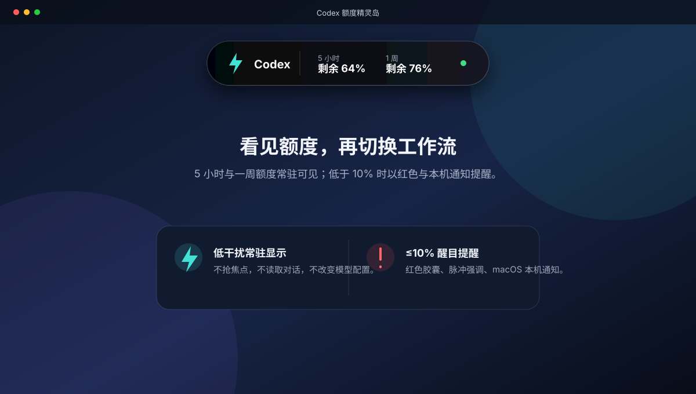

# Codex 额度精灵岛

> 在 Codex 额度耗尽前看见它，并在合适的时机手动切换到你已配置的第三方模型、Harness Agent 或其他工作流。

`Codex 额度精灵岛` 是一个原生 macOS 常驻小工具。它以一个不抢焦点的顶部小胶囊，显示 Codex 的 **5 小时**和**一周**额度剩余量；任一窗口剩余量不超过 **10%** 时，胶囊会变红并发出 macOS 本机通知。



## 它解决什么问题

Codex 的 ChatGPT 方案额度可能同时受 5 小时和一周窗口约束。即使你另外配置了第三方模型或网关，Codex 自身的登录、发消息与工作流是否可继续，仍取决于客户端和额度策略。

本工具**不绕过额度限制、不替 Codex 或 Harness Agent 发送消息，也不自动切换模型**。它的职责只是把剩余额度持续、醒目地展示出来，使你在额度接近耗尽时主动切换到已经配置好的其他模型或工作流。

## 功能

- 显示 Codex 5 小时和一周窗口的剩余额度。
- 可直接拖动顶部胶囊，避开当前正在使用的内容区域。
- 默认每 60 秒读取一次真实额度；窗口重置后自动展示新周期。可按机器性能配置为最快 10 秒一次。
- 任一窗口剩余量 `≤10%` 时：红色高亮、脉冲视觉提示、macOS 通知与提示音。
- 登录 macOS 后自动启动；异常退出后自动重启。
- 不读取聊天内容，不修改 Codex 配置，不中止对话，不上传任何额度数据。
- 不包含任何第三方模型地址、API Key、访问令牌或账户信息。

## 工作原理

```text
已登录的 Codex / ChatGPT 身份
             │
             ▼
本机 codex app-server（标准输入输出，仅查询）
             │ account/rateLimits/read
             ▼
Codex 额度精灵岛 ──► 顶部胶囊 + 低额度本机提醒
```

为避免常驻一份高内存的 App Server，本工具每次读取额度时短暂启动本地 `codex app-server`，完成后立即退出。它不开放监听端口，不向网络中的其他设备提供接口。

官方 App Server 的 `account/rateLimits/read` 返回当前窗口的使用比例、窗口时长及重置时间；工具将其转换为剩余百分比显示。[OpenAI Docs：Codex App Server](https://learn.chatgpt.com/docs/app-server#6-rate-limits-chatgpt)

## 第三方模型的边界

本项目与第三方模型**解耦**：

- 你可以在 Codex 的用户级配置、企业网关或其他客户端中配置国产模型；本工具只观察 Codex 额度，不读取该配置。
- 不要把模型地址、API Key、访问令牌、Cookie、代理密码或组织标识写入本仓库、Issue、日志或截图。
- 当胶囊低于 10% 时，请由你手动切换到已验证的第三方模型；本工具不会自行切换，也不保证额度归零后 Codex 客户端仍可接收新消息。

面向自动化代理的完整配置步骤见 [大模型操作手册](docs/LLM_RUNBOOK_zh-CN.md)。

## 快速开始

### 前置条件

- macOS 14 或更高版本。
- 已安装并登录 Codex 桌面应用或 Codex CLI。
- Xcode Command Line Tools / Xcode，包含 Swift 6。

### 构建与试运行

```zsh
git clone <你的 GitHub 仓库地址>
cd codex-quota-island
swift test
./scripts/build-app.sh
open ".build/release-app/Codex 额度精灵岛.app"
```

首次运行时，请在 macOS 的通知授权提示中选择允许；否则低额度时仍会变红，但系统横幅和声音无法保证出现。

### 安装为登录启动项

确认试运行无误后：

```zsh
ditto ".build/release-app/Codex 额度精灵岛.app" "/Applications/Codex 额度精灵岛.app"
cp scripts/com.wyn.codex-quota-island.plist "$HOME/Library/LaunchAgents/"
launchctl bootstrap "gui/$(id -u)" "$HOME/Library/LaunchAgents/com.wyn.codex-quota-island.plist"
```

验证状态：

```zsh
launchctl print "gui/$(id -u)/com.wyn.codex-quota-island"
pgrep -fal CodexQuotaIsland
```

### 调整额度刷新频率

默认值为 **60 秒**。这不是固定限制：性能充裕的 Mac 可降到 **10 秒**，以缩短低额度提醒的最坏延迟；较低性能设备应保留默认值或调高。有效范围为 **10–3600 秒**，小于 10 秒会自动按 10 秒处理。

例如，改为每 10 秒刷新一次：

```zsh
defaults write com.wyn.codex-quota-island refreshIntervalSeconds -int 10
launchctl kickstart -k "gui/$(id -u)/com.wyn.codex-quota-island"
```

恢复默认 60 秒：

```zsh
defaults delete com.wyn.codex-quota-island refreshIntervalSeconds
launchctl kickstart -k "gui/$(id -u)/com.wyn.codex-quota-island"
```

每次刷新会短暂启动本机 App Server；频率越高，提醒越及时，但短时 CPU、内存峰值和网络请求也随之增加。本机实测单次查询约 2 秒，因此 10 秒间隔理论上会让查询进程约 20% 的时间处于活动状态。是否启用 10 秒应以目标 Mac 的实际 CPU、内存与工作负载测量为准，而不是只按“配置较强”判断。

### 卸载

```zsh
launchctl bootout "gui/$(id -u)" "$HOME/Library/LaunchAgents/com.wyn.codex-quota-island.plist"
rm "$HOME/Library/LaunchAgents/com.wyn.codex-quota-island.plist"
rm -rf "/Applications/Codex 额度精灵岛.app"
```

以上命令只移除本工具与其启动项，不会改动 Codex、ChatGPT、第三方模型配置或对话记录。

## 性能

| 指标 | 已测结果 |
| --- | ---: |
| 常驻界面物理内存 | 约 19.4 MB |
| 空闲 CPU | 0.0% |
| 单次额度查询时长 | 约 2 秒 |
| 单次查询的临时峰值内存 | 约 147 MB，结束后释放 |
| 常驻 App Server 进程 | 无 |

这些数据来自 Apple Silicon Mac 的本机测量，不构成所有硬件和 Codex 版本上的性能保证。建议首次安装后用“活动监视器”观察至少 8 小时。

## 隐私与安全

- 源代码中不含 API Key、Token、密码、Cookie 或固定第三方网关地址。
- 应用通过本地进程的标准输入输出查询额度；不建立 TCP/WebSocket 监听服务。
- 只读取 `account/rateLimits/read`，不调用额度重置、对话中止、文件读取或配置写入接口。
- 发布前请执行 `rg -l -i '(api[_-]?key|access[_-]?token|secret|password|sk-)' .`，确认命中内容仅为文档中的安全说明或示例字段。

## 许可证

在公开发布前，请补充与你的发布策略一致的许可证文件。
